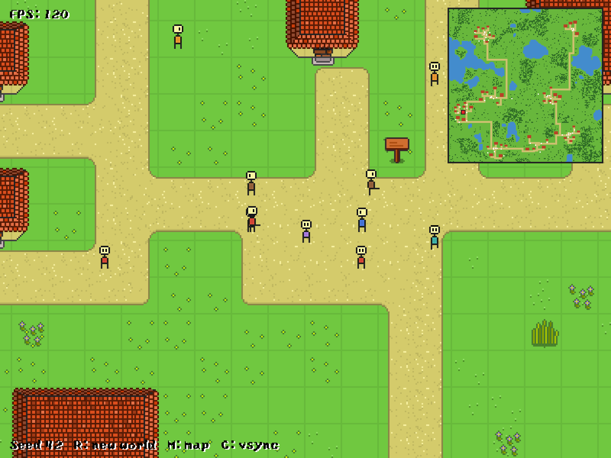

# The invasion of the evil lords

A small 2D action game written in C with [SDL3](https://libsdl.org), after
the [original web game](https://batiste.github.io/games/rpg/game.html).
Demons attack the villages of a procedurally generated world: survive the
waves, protect the villagers and slay the evil lord.



## How to play

- Move with WASD or the arrow keys. Your weapons strike on their own.
- Waves of demons come for you. They bite any villager in their way, and the
  villagers they kill rise again as skeletons. Lords spit green blobs; the
  evil lord, every fifth wave, fires red ones. Killing him wins the game.
- Fallen demons leave blue souls: walk near them to gain experience. Each
  level offers three upgrades to choose from (keys 1 to 3): sword, throwing
  stones, spirit flames, holy ground, swift boots, vitality, might, haste
  and soul magnet. Some demons drop hearts.
- Demons cannot enter houses. Villagers hide there, and time stands still
  while you are inside.
- Between waves, click Next wave (or press Enter) to call the next one.

## Features

- **Procedural worlds** (160×160 tiles) from a seed
  - lakes and forests from fractal noise
  - 7–8 villages, each with a plaza, 4–8 houses and a footpath to every door
  - roads between villages: a minimum spanning tree plus a few shortcuts,
    routed with A\* so they wind around lakes, houses and forests
  - water and path tiles autotiled with proper edges and corners
  - gardens with fences and flower beds, village signs, reeds, lily pads
- **Villagers** with different shirt colours live in the houses. They come
  out, walk the roads to the plaza, visit neighbours, sometimes travel to
  another village, and go back inside. Pigs potter around the villages.
- **Varied houses**: a few cottages and houses from 4 to 6 tiles wide, assembled
  from corner, edge and middle pieces, with hipped, gabled or thatched roofs.
  12 colour styles (roof, walls, floor) stay close to the original palette;
  each village has its own styles and a favourite roof shape. Entrances have
  a door and a stone landing; other columns of the facade get windows.
- **Furnished interiors**: shelves, cupboards and beds against the back wall,
  chests and barrels along the sides, a table with chairs, a rug by the door,
  and a fireplace under the chimney, whose smoke rises from the roof.
- **Enterable houses**: walls have real collision with a door opening; step
  inside and the roof fades away to show the room and whoever is home.
  Villagers walk in and out through the door too.
- Depth-sorted rendering, so characters walk behind trees and houses
- Village name banner when you arrive, greetings from nearby villagers, minimap
- Fixed-timestep simulation (50 Hz) with interpolated rendering; same game
  speed with vsync on or an uncapped frame rate
- The view follows the window's aspect ratio (resizable, fullscreen with F),
  scaled by a whole factor so the pixel art stays crisp, HiDPI aware

## Controls

| Key                 | Action                          |
| ------------------- | ------------------------------- |
| W A S D / arrows    | Move (physical keys, so it works on AZERTY too) |
| 1, 2, 3             | Choose an upgrade               |
| Enter               | Start, continue, next wave      |
| R                   | Generate a new world            |
| M                   | Toggle the minimap              |
| N                   | Pause / resume the music        |
| F or F11            | Toggle fullscreen               |
| C                   | Toggle vsync / uncapped FPS     |
| Esc                 | Quit                            |

Any key skips the splash screen. Start on a given world with
`./build/game --seed 42`; the current seed is shown at the bottom of the screen.

## Building

Requirements: a C17 compiler, CMake ≥ 3.24, SDL3, SDL3_image, SDL3_ttf and
SDL3_mixer (3.x).

### macOS

```sh
brew install cmake sdl3 sdl3_image sdl3_ttf sdl3_mixer
cmake -S . -B build
cmake --build build
./build/game
```

### Linux

Install the same libraries from your distribution (or build SDL3 from source),
then use the same CMake commands.

### Debugging

```sh
cmake -S . -B build-asan -DENABLE_SANITIZERS=ON
cmake --build build-asan
./build-asan/game
```

Assets are copied next to the executable at build time and located with
`SDL_GetBasePath()`, so the game can be launched from any directory.

## Tilesets

| File                | Contents                                           |
| ------------------- | -------------------------------------------------- |
| `assets/ground.png` | grass variants and the palm tree                   |
| `assets/tiles.png`  | houses and the pig; grass made transparent and houses recoloured at load time |
| `assets/nature.png` | water, path, bushes, rocks, flowers, fences...     |
| `assets/character.png` | player sprite sheet; villagers are recoloured copies |

`assets/nature.png`, `assets/roofs.png` (gabled and thatched roofs) and
`assets/furniture.png` are generated in the style of the original art by
`tools/gen_nature_tiles.py` and `tools/gen_house_tiles.py`; edit the scripts
and re-run them with Pillow installed (`pip install pillow`) to tweak or add
tiles. Tile ids for all
tilesets are defined in `src/tiles.h`.

## Layout

| File             | Purpose                                              |
| ---------------- | ---------------------------------------------------- |
| `src/main.c`     | Game loop, player, camera, rendering, HUD, music     |
| `src/combat.*`   | Waves, demons, weapons, upgrades, souls              |
| `src/worldgen.c` | Procedural world generation                          |
| `src/world.*`    | World data, collisions and walker path finding       |
| `src/npc.*`      | Villager and pig behaviour                           |
| `src/pathfind.*` | Generic A\* on a grid                                |
| `src/atlas.*`    | Tilesets, recoloured villagers, the pig              |
| `src/engine.*`   | Window, renderer, audio, asset loading and cleanup   |
| `src/sprite.*`   | Sprites and sprite-sheet animations                  |
| `src/tiles.h`    | Tile ids                                             |
